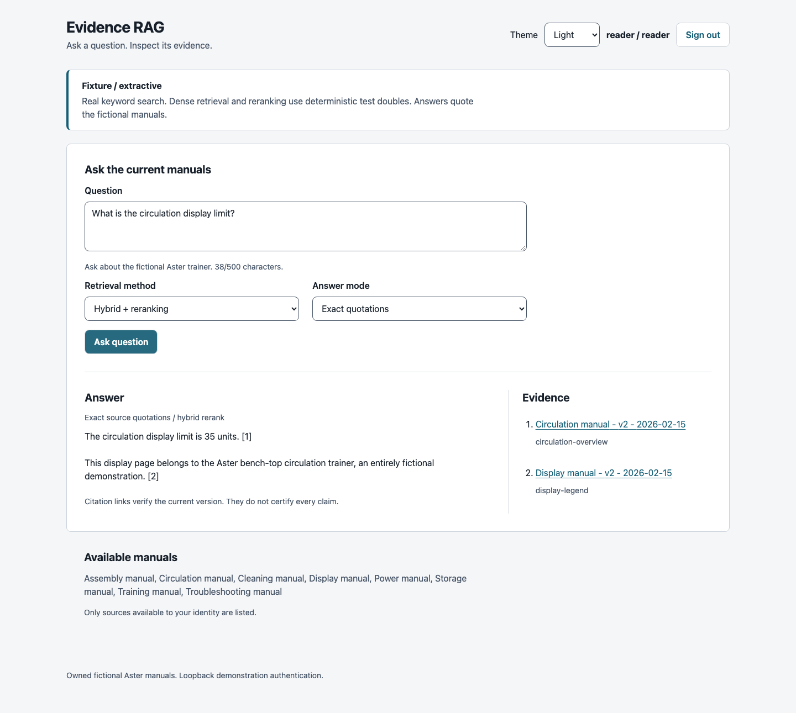
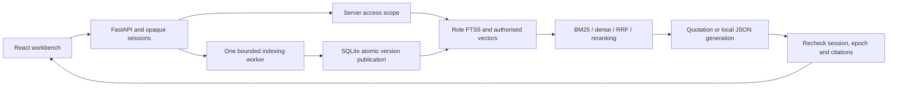

# Evidence RAG

A local evidence workbench that answers questions from current document versions, shows exact source passages, and enforces reader/maintainer access before retrieval and response publication.



V1 is implemented locally. It includes four retrieval methods, a React interface, transactional replacement/deletion, server-side demo sessions and reproducible evaluation. No public repository, push, hosted deployment or customer pilot is claimed. The sample manuals describe an invented Aster trainer and are not real equipment instructions.

## Run it

From this checkout with uv, Python 3.12 and Node 24 LTS on PATH:

```sh
export UV_CACHE_DIR="$PWD/.runtime/uv-cache"
export npm_config_cache="$PWD/.runtime/npm-cache"
uv sync --frozen
npm --prefix web ci
uv run evidence-rag init
uv run evidence-rag seed-fixtures
uv run uvicorn evidence_rag.app:create_default_app --factory --host 127.0.0.1 --port 8115 --no-access-log
```

In a second terminal run `npm --prefix web run dev`, then open `http://127.0.0.1:5115`. Use a launch code printed by `init`. Reader sees eight manuals; maintainer can also inspect four appendices and maintain documents. Ask `What is the circulation display limit?`, then open its v2 citation. Ask `Which lunar alloy is used?` for an abstention.

The default fixture mode needs no account or model download. FTS5 is real; dense embeddings and reranking are deterministic test doubles, clearly labelled. Quotation answers copy source sentences. Optional actual BGE/MiniLM/Qwen snapshots are pinned separately; see the [runbook](docs/RUNBOOK.md).

`init` refuses existing launch codes. Use explicit `reset` with the API stopped to rotate codes and revoke sessions. Do not reseed an existing corpus. Runtime files, databases, codes, models and bulk reports stay under the ignored `.runtime` directory.

## Why this project

In the fictional workflow, a reader searches manuals, checks the edition and permission, then copies a supporting passage. This implementation makes those checks part of the same application flow. A maintainer can replace a version while readers are asking questions, or delete a document without leaving a usable stale citation or cached answer.

The engineering focus is delivery: typed browser/API contracts, failure states, access-filtered retrieval, a repeatable demonstration, measurable baselines and explicit limits. It is an original simulation rather than a claim of production customer impact.

## Architecture



One API process owns an asynchronous publication lock. Retrieval/generation runs outside it. The final permission/version check, cache insertion and complete response body send run under the same lock as mutation publication. If documents change first, the answer is discarded with 409. If the response has started publishing first, delete waits until its complete body has been sent.

SQLite WAL transactions publish source metadata, exact Unicode chunks, vectors, role-partitioned FTS indexes, role epochs and cache invalidation together. Reader vectors are filtered before scoring; separate FTS tables prevent hidden documents changing reader ranking statistics. Rebuilds validate retained source/chunk equality. Superseded ordinary links fail; explicit history is maintainer-only. Delete clears source bodies and source metadata from application tombstones, cancels staged replacements and cannot be undone by a late worker.

The web client uses generated OpenAPI TypeScript types plus Zod response validation. Source is escaped text, including HTML and hostile instructions. Both themes, mobile layout, error focus and dialog focus return are exercised in real Chromium. Authentication is explicitly a loopback demo, not a production identity provider.

## Measured quality and its limits

The bounded quality pass compares an unchanged baseline with a general evidence-intent policy, using the same local Qwen3 14B snapshot and strict decoder. Two development iterations were allowed; the second regressed quoted-request handling, so the first was restored exactly before one frozen final evaluation. The pre-registered quality gate failed: regression_refusals, regression_coverage, challenge_no_unverified_answers. Exact quotations remain the default. No final-output tuning, oracle relaxation or third policy iteration occurred.

The exposed-test targets were 48/48 proper refusals and at least 116/144 answerable responses; observed 47/48 and 109/144 miss both. Hybrid still answers test-041 with `restricted calibration review marker`, citing the public training quotation instead of refusing a value question. No private marker is disclosed. The general grounding defect is reduced, not eliminated, and answerable response coverage did not improve.

The new 24-question challenge was authored by a separate AI agent, with source-grounded answerability, complete reference answers, finite whole-answer patterns and required cited support. Inputs/oracles and acceptance criteria were frozen before final evaluation. Shared fictional sources and related facts mean it is not statistically independent. It is not human-reviewed.

| Challenge policy | Proper refusals | Answerable responses | Oracle-verified complete | Unverified responses | Invalid | Citations resolve |
| --- | --- | --- | --- | --- | --- | --- |
| Unchanged v4 baseline | 30/32 | 64/64 | 56/64 | 10 | 0 | 66/66 |
| Selected candidate | 32/32 | 60/64 | 57/64 | 3 | 0 | 60/60 |

| Exposed test | Proper refusals | Answerable responses | Invalid | Citations resolve |
| --- | --- | --- | --- | --- |
| Recorded v4 | 46/48 | 109/144 | 0 | 120/120 |
| Selected candidate | 47/48 | 109/144 | 0 | 126/126 |

Response coverage counts any non-refused answer. Narrow-oracle coverage additionally requires a complete permitted wording and all required supporting source quotes. A correct paraphrase can fail the finite oracle; a resolving citation alone never establishes factual support. Detailed counts, failures, pins, hashes, commands and the pre-registered verdict are in [quality results](docs/QUALITY-RESULTS.md) and [evaluation](EVALUATION.md).

The native paired regression still fails on two completeness cases: a bare `No` omits a current-value correction, and `13` omits what was counted. A development failure also substitutes another subject's accessible public value for a private subject's missing fact. No access/citation rule was weakened to increase coverage. This small simulation does not establish broad factuality, human usefulness or customer impact.

The actual API lifecycle matrix passed 96 requests across four retrieval methods, both roles, answer modes, cache states and active/replaced/deleted documents. The actual browser capture exercises native Qwen, real BM25 and the API with no intercepted fetches. Watch the [35-second local demo](docs/demo/quality-v1.mp4); reading pauses are not inference timings. Both that model evidence and the fixture-only quickstart are labelled explicitly.

See the [case study](docs/CASE-STUDY.md), [publication audit](docs/PUBLICATION-AUDIT.md) and [licence/provenance record](docs/PROVENANCE.md). All 24 pre-pass reports remain unchanged. Historical generation-format and abstention repairs are retained separately; the original test is exposed regression evidence, not a fresh holdout. Human factual support/completeness and screen-reader use remain unmeasured.

## Checks and operation

```sh
./scripts/check.sh
export PLAYWRIGHT_BROWSERS_PATH="$PWD/.runtime/ms-playwright"
npm --prefix web exec -- playwright install chromium
npm --prefix web run test:e2e
./scripts/clean_clone_check.sh
```

The check script runs Ruff, strict Pyright, socket-restricted fixture tests, strict TypeScript including tests, Vitest, a production build, OpenAPI/type drift and corpus validation. Browser tests launch the actual API and web servers on 8115/5115 with a fresh database, genuine sessions and no intercepted fetch. Actual-model tests are separate and acquire the shared machine lease.

- [Operating and recovery runbook](docs/RUNBOOK.md)
- [Verification evidence and remaining limits](docs/VERIFICATION.md)
- [Current state](docs/STATE.md)
- [Specification](docs/SPEC.md) and [implementation plan](docs/superpowers/plans/2026-10-15-v1.md)
- [Contributing](CONTRIBUTING.md) and [security boundaries](SECURITY.md)

Code, original docs and fictional data: [MIT](LICENSE). BGE is MIT; MiniLM and Qwen use Apache-2.0 terms recorded with their [pinned snapshot provenance](config/models.lock.json). Weights are not included. There are no enterprise connectors, OCR/PDF ingestion, hosted inference, real machinery instructions or private customer documents in v1.
