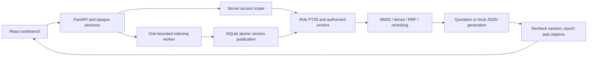

# Evidence RAG

A local evidence workbench that answers questions from current document versions, shows exact source passages, and enforces reader/maintainer access before retrieval and response publication.


V1 is implemented locally. It includes four retrieval methods, a React interface, transactional replacement/deletion, server-side demo sessions and reproducible evaluation. No public repository, push, hosted deployment or customer pilot is claimed. The sample manuals describe an invented Aster trainer and are not real equipment instructions.

## Run it

From this checkout with uv, Python 3.12 and Node 24 LTS on PATH:

```sh
export UV_CACHE_DIR="$PWD/.runtime/uv-cache"
export npm_config_cache="$PWD/.runtime/npm-cache"
uv sync --frozen
npm --prefix web ci
uv run evidence-rag init
uv run evidence-rag seed-fixtures
uv run uvicorn evidence_rag.app:create_default_app --factory --host 127.0.0.1 --port 8115 --no-access-log
```

In a second terminal run `npm --prefix web run dev`, then open `http://127.0.0.1:5115`. Use a launch code printed by `init`. Reader sees eight manuals; maintainer can also inspect four appendices and maintain documents. Ask `What is the circulation display limit?`, then open its v2 citation. Ask `Which lunar alloy is used?` for an abstention.

The default fixture mode needs no account or model download. FTS5 is real; dense embeddings and reranking are deterministic test doubles, clearly labelled. Quotation answers copy source sentences. Optional actual BGE/MiniLM/Qwen snapshots are pinned separately; see the [runbook](docs/RUNBOOK.md).

`init` refuses existing launch codes. Use explicit `reset` with the API stopped to rotate codes and revoke sessions. Do not reseed an existing corpus. Runtime files, databases, codes, models and bulk reports stay under the ignored `.runtime` directory.

## Why this project

In the fictional workflow, a reader searches manuals, checks the edition and permission, then copies a supporting passage. This implementation makes those checks part of the same application flow. A maintainer can replace a version while readers are asking questions, or delete a document without leaving a usable stale citation or cached answer.

The engineering focus is delivery: typed browser/API contracts, failure states, access-filtered retrieval, a repeatable demonstration, measurable baselines and explicit limits. It is an original simulation rather than a claim of production customer impact.

## Architecture



One API process owns an asynchronous publication lock. Retrieval/generation runs outside it. The final permission/version check, cache insertion and complete response body send run under the same lock as mutation publication. If documents change first, the answer is discarded with 409. If the response has started publishing first, delete waits until its complete body has been sent.

SQLite WAL transactions publish source metadata, exact Unicode chunks, vectors, role-partitioned FTS indexes, role epochs and cache invalidation together. Reader vectors are filtered before scoring; separate FTS tables prevent hidden documents changing reader ranking statistics. Rebuilds validate retained source/chunk equality. Superseded ordinary links fail; explicit history is maintainer-only. Delete clears source bodies and source metadata from application tombstones, cancels staged replacements and cannot be undone by a late worker.

The web client uses generated OpenAPI TypeScript types plus Zod response validation. Source is escaped text, including HTML and hostile instructions. Both themes, mobile layout, error focus and dialog focus return are exercised in real Chromium. Authentication is explicitly a loopback demo, not a production identity provider.

## Measured results and limits

The frozen test set has 48 questions, with 36 having labelled relevant sections. On this small repetitive owned corpus, all four actual retrieval methods achieved recall@5 of 1.0. Dense and hybrid MRR were 1.0 versus BM25 and reranked hybrid 0.9861. MiniLM did not improve MRR and increased warm quotation p50 from 2.15 ms for BM25 to 90.23 ms. These warmed-worker measurements exclude separately recorded load/index warmup and are not interactive cold-start latency.

The repaired local Qwen block accepted 183/192 test answers, returned two insufficient-evidence abstentions and rejected seven invalid outputs. All 347 emitted citations resolved to accessible current passages. Passing these checks does not establish factual support.

The original Qwen policy rejected all 96 development and 192 test outputs. [Diagnosis and repair](docs/GENERATION-REPAIR.md) explain the key/ID errors, unsuccessful prompt-only probes and constrained decoding with a two-citation generation budget. Server validation, exact IDs, access/version checks and final response revalidation remain strict. The same pinned model, corpus and questions were retained; held-out outputs did not change parameters.

Qwen still answers unsupported questions incorrectly. Only 1/48 expected-abstention test cases abstained, through invalid-output rejection; no explicit insufficient-evidence response correctly handled an expected-abstention case. Exact quotations remain the default; they can also select irrelevant matching sentences and correctly abstained on 8/12 expected-abstention cases per actual test method. Human citation support/completeness remain unmeasured.

[Evaluation protocol](EVALUATION.md) and [recorded evidence](reports/README.md) retain the new results and original failures separately, with hashes, counts, role/stratum aggregates and paired confidence intervals. Fixture and actual-model results remain separate.

## Checks and operation

```sh
./scripts/check.sh
export PLAYWRIGHT_BROWSERS_PATH="$PWD/.runtime/ms-playwright"
npm --prefix web exec -- playwright install chromium
npm --prefix web run test:e2e
./scripts/clean_clone_check.sh
```

The check script runs Ruff, strict Pyright, socket-restricted fixture tests, strict TypeScript including tests, Vitest, a production build, OpenAPI/type drift and corpus validation. Browser tests launch the actual API and web servers on 8115/5115 with a fresh database, genuine sessions and no intercepted fetch. Actual-model tests are separate and acquire the shared machine lease.

- [Operating and recovery runbook](docs/RUNBOOK.md)
- [Verification evidence and remaining limits](docs/VERIFICATION.md)
- [Current state](docs/STATE.md)
- [Specification](docs/SPEC.md) and [implementation plan](docs/superpowers/plans/2026-10-15-v1.md)
- [Contributing](CONTRIBUTING.md) and [security boundaries](SECURITY.md)

Code, original docs and fictional data: [MIT](LICENSE). BGE is MIT; MiniLM and Qwen use Apache-2.0 terms recorded with their [pinned snapshot provenance](config/models.lock.json). Weights are not included. There are no enterprise connectors, OCR/PDF ingestion, hosted inference, real machinery instructions or private customer documents in v1.
